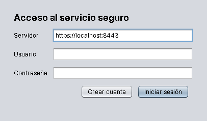
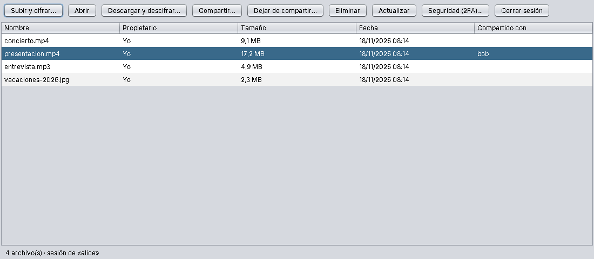
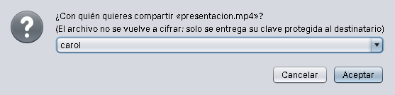
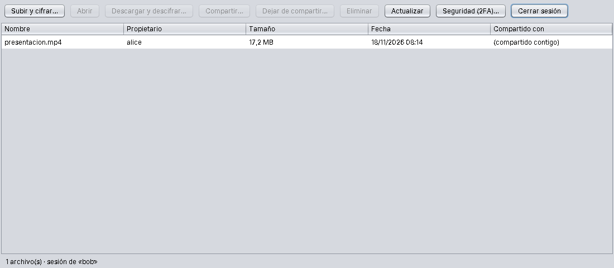
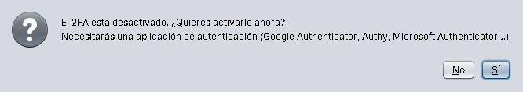
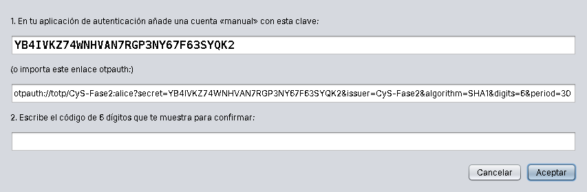

# Servicio seguro de contenidos multimedia — Fase II
Compresión y Seguridad 2026-2027 · Universidad de Alicante

Sistema **cliente–servidor** para guardar archivos multimedia cifrados, con usuarios, segundo factor (2FA) y compartición segura entre usuarios. Hecho en **Java 17+**, interfaz **Swing**, servidor con `com.sun.net.httpserver` y **sin librerías externas**.

## 1. Contenido del proyecto

| Carpeta / archivo | Descripción |
|---|---|
| `servidor/` | Servidor REST (separado del cliente): usuarios, JWT, 2FA, almacén de blobs cifrados |
| `cliente/` | Aplicación de escritorio (Swing) y toda la criptografía de cliente |
| `comun/` | JSON mínimo compartido por ambos |
| `pruebas/` | Prueba de integración automática (40 comprobaciones) y generador de capturas |
| `docs/SEGURIDAD.md` | Capítulo de seguridad con la notación explicada |
| `docs/capturas/` | Capturas reales de la aplicación |
| `fase1/` | Código de la Fase I (un solo usuario) |
| `*.bat` / `*.sh` | Scripts para compilar y ejecutar (Windows / Linux-macOS) |

## 2. Instalación y arranque (Windows)

Necesitas un **JDK 17 o superior** (comando `javac`). Dentro de la carpeta del proyecto:

1. **Servidor**: doble clic en `ejecutar-servidor.bat`. La primera vez compila y genera un certificado TLS (`certs/`). Déjalo abierto: debe mostrar `Escuchando en https://0.0.0.0:8443/api`.
2. **Cliente**: doble clic en `ejecutar-cliente.bat` (puedes abrir varios para probar con varios usuarios).
3. **Pruebas automáticas** (opcional): `ejecutar-pruebas.bat`.

En Linux/macOS: `sh ejecutar-servidor.sh`, `sh ejecutar-cliente.sh`, `sh ejecutar-pruebas.sh`. Los datos del servidor quedan en `datos-servidor/`.
Si el servidor está en otro equipo, copia `certs/truststore.p12` junto al cliente y escribe `https://IP-del-servidor:8443` en la pantalla de acceso.

## 3. Manual de usuario

### 3.1 Crear una cuenta e iniciar sesión


1. Comprueba que **Servidor** es la dirección del servidor (por defecto `https://localhost:8443`).
2. Escribe un **usuario** (3-32 caracteres: letras, números, `.`, `_`, `-`) y una **contraseña de al menos 8 caracteres**.
3. Pulsa **Crear cuenta** (tarda unos segundos: se generan tus claves). Después pulsa **Iniciar sesión**.

> ⚠️ **Apunta bien tu contraseña.** No existe «recuperar contraseña»: tus archivos están cifrados con claves protegidas por ella y nadie, ni el servidor, puede abrirlos sin ella.

### 3.2 Pantalla principal


La tabla muestra tus archivos y los que otros usuarios han compartido contigo. Con un archivo seleccionado:

| Botón | Qué hace |
|---|---|
| **Subir y cifrar…** | Elige uno o varios archivos. Se cifran **en tu equipo** y solo se sube el contenido cifrado. Al terminar puedes borrar los originales |
| **Abrir** (o doble clic) | Descifra una copia temporal y la abre con el programa del sistema (reproductor, visor…). La copia se borra al cerrar sesión |
| **Descargar y descifrar…** | Guarda el archivo descifrado en la carpeta que elijas |
| **Compartir…** | Da acceso a otro usuario (solo si el archivo es tuyo) |
| **Dejar de compartir…** | Retira el acceso a un usuario |
| **Eliminar** | Borra el archivo del servidor (si es tuyo) o lo quita de tu lista (si te lo compartieron) |
| **Seguridad (2FA)…** | Activa o desactiva el segundo factor |
| **Cerrar sesión** | Sale y borra las copias temporales |

### 3.3 Compartir un archivo


Selecciona tu archivo → **Compartir…** → elige al usuario. El archivo **no se vuelve a cifrar ni a subir**: solo se entrega al destinatario la clave del archivo protegida con *su* clave pública. El destinatario lo verá en su lista:



### 3.4 Activar el segundo factor (2FA)


1. Pulsa **Seguridad (2FA)…** → **Sí**.
2. En tu app de autenticación (Google Authenticator, Authy, Microsoft Authenticator…) añade una cuenta **manualmente** con la clave que aparece.
3. Escribe el código de 6 dígitos y pulsa **Aceptar**.



Desde ese momento, al iniciar sesión se te pedirá también el código. Para desactivarlo, vuelve a **Seguridad (2FA)…** e introduce un código.

### 3.5 Problemas habituales
| Mensaje | Causa y solución |
|---|---|
| «No se pudo conectar con el servidor» | El servidor no está arrancado o la dirección es incorrecta |
| «Usuario o contraseña incorrectos» | Revisa ambos datos; tras 5 fallos hay que esperar 1 minuto |
| «Código 2FA incorrecto» | 1) La **hora** del ordenador y la del móvil deben estar sincronizadas (máx. 30 s de diferencia). 2) La cuenta de tu app debe corresponder a la clave que muestra **ahora** el diálogo: si dudas, borra la cuenta «CyS-Fase2» de la app y vuelve a añadirla con la clave actual. 3) El código se puede escribir con o sin espacio |
| «La sesión ha caducado» | Han pasado más de 30 min sin actividad: inicia sesión de nuevo |
| Error de certificado | Ejecuta el cliente con `ejecutar-cliente.bat` (usa el almacén `certs/truststore.p12`) |

*(Las capturas se generaron en un entorno de pruebas; el aspecto de las ventanas puede variar según el sistema operativo.)*

## 4. Implementación

### 4.1 Arquitectura
```
 Cliente (Swing)                          Servidor (REST/JSON sobre HTTPS)
 ┌────────────────────┐   JWT en cabecera ┌──────────────────────────────┐
 │ gui/               │ ────────────────► │ Api.java  (rutas y permisos) │
 │ ClienteServicio    │                   │ Jwt, Totp, Cripto            │
 │ crypto/Cripto      │ ◄──────────────── │ Database (db.json + blobs/)  │
 │ net/ApiClient      │                   └──────────────────────────────┘
 └────────────────────┘
 Todo el cifrado y descifrado ocurre en el cliente. El servidor solo ve datos opacos.
```

### 4.2 API REST
| Método y ruta | Auth | Descripción |
|---|---|---|
| `GET /api/auth/sal?usuario=` | – | Sal e iteraciones del PBKDF |
| `POST /api/auth/registro` | – | Alta (sal, mitad de autenticación, clave pública y clave privada protegida) |
| `POST /api/auth/login` | – | Devuelve token de acceso o token pendiente de 2FA |
| `POST /api/auth/2fa` | pendiente | Segundo paso con el código TOTP |
| `POST /api/auth/renovar` · `/logout` | acceso | Renueva o revoca el token |
| `GET /api/yo` | acceso | Mis claves (la clave privada ya protegida) |
| `POST /api/2fa/configurar` · `/activar` · `/desactivar` | acceso | Gestión del 2FA |
| `GET /api/usuarios` · `/api/usuarios/{u}/clavepublica` | acceso | Directorio y claves públicas |
| `GET /api/archivos` | acceso | Mis archivos y los compartidos conmigo |
| `POST /api/archivos` | acceso | Subir contenido cifrado (cabeceras `X-Nombre-Cifrado`, `X-Clave-Envuelta`) |
| `GET /api/archivos/{id}/contenido` | acceso | Descargar el contenido cifrado |
| `DELETE /api/archivos/{id}` | acceso | Borrar (propietario) o quitar de mi lista |
| `POST /api/archivos/{id}/compartir` | acceso | Compartir (solo propietario) |
| `DELETE /api/archivos/{id}/compartir/{u}` | acceso | Revocar (solo propietario) |

### 4.3 Clases principales
| Clase | Responsabilidad |
|---|---|
| `cliente.crypto.Cripto` | SHA3-256, PBKDF-SHA3, AES-128-GCM, RSA-2048-OAEP |
| `cliente.ClienteServicio` | Registro, login, 2FA, subir/descifrar/abrir, compartir (sin interfaz) |
| `cliente.net.ApiClient` | Llamadas HTTP, token y renovación automática |
| `cliente.gui.*` | Ventanas Swing |
| `servidor.Api` | Rutas REST, permisos, anti-fuerza-bruta, revocación de tokens |
| `servidor.Jwt` / `Totp` / `Cripto` | JWT HS256, TOTP RFC 6238, primitivas del servidor |
| `servidor.Database` | Persistencia en `db.json` y `blobs/` |

### 4.4 Decisiones de diseño
* **Una contraseña, dos claves**: el KDF produce 256 bits; la primera mitad autentica ante el servidor y la segunda protege la clave privada. El usuario solo escribe una contraseña.
* **PBKDF propio con SHA3-256** (sal + 200 000 iteraciones), no PBKDF2.
* **No se reencripta**: compartir solo envuelve de nuevo la clave del archivo con la clave pública del destinatario.
* **AES-128-GCM** en lugar de CTR: sigue siendo AES-128 pero añade integridad.
* **Tokens JWT** sin estado en el servidor, con caducidad y payload sin datos sensibles.
* Detalle y notación completa en [`docs/SEGURIDAD.md`](docs/SEGURIDAD.md).

## 5. Pruebas
`ejecutar-pruebas.bat` levanta un servidor real con TLS y ejecuta 40 comprobaciones de extremo a extremo: registro, login, 2FA con anti-repetición, cifrado, ausencia de datos en claro en el servidor, compartición sin reencriptar, revocación, permisos, tokens falsos o con `alg=none`, detección de manipulación y borrado.
